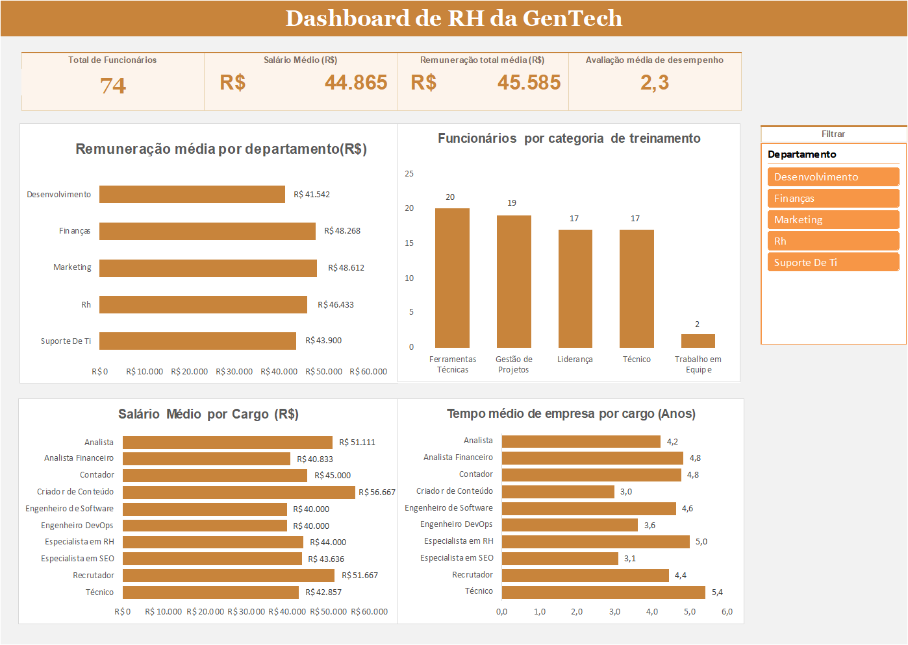

# Desafios Técnicos — Turma AD05 (Generation Brasil)

Repositório com exercícios, notebooks e planilhas desenvolvidos durante a formação de Análise de Dados da Generation Brasil (turma AD05), cobrindo Python, estatística aplicada, consumo de API e construção de dashboards no Excel.

## Entregas no repositório

| Arquivo | Ferramenta | O que aborda |
| :--- | :--- | :--- |
| `Desafio_01_Atendimento_Cliente - clientes.csv` | Dados (CSV) | Base de dados de atendimento ao cliente utilizada nas análises |
| `Desafio1_API_Python.ipynb` | Python (Colab) | Consumo e tratamento de dados via API em Python |
| `01_estatistica_descritiva.ipynb` | Python (Colab) | Medidas descritivas e exploração inicial de distribuições |
| `03_covariancia_e_correlacao.ipynb` | Python (Colab) | Relação entre variáveis numéricas com covariância e correlação |
| `Desafio3_Excel_Modelo 3.xlsx` | Excel | Tratamento de base, tabelas dinâmicas, KPIs e dashboard de atendimento ao cliente |
| `Diogo_Rabelo_Excel_Projeto_Avaliacao10.xlsx` | Excel | Projeto avaliativo com fórmulas, análises e estruturação de relatório |

## Observações gerais

* Parte dos conjuntos de dados utilizados nos exercícios possui caráter didático/fictício para prática de modelagem, limpeza e leitura de indicadores.
* Nos dashboards em Excel, o foco foi manter indicadores claros, leitura objetiva dos gráficos e recomendações ligadas às evidências da base.

## Prévia dos Dashboards

### Atendimento ao Cliente

### RH — GenTech

## Autor

**Diogo Rabelo** — [@drabelo-projects](https://github.com/drabelo-projects)
